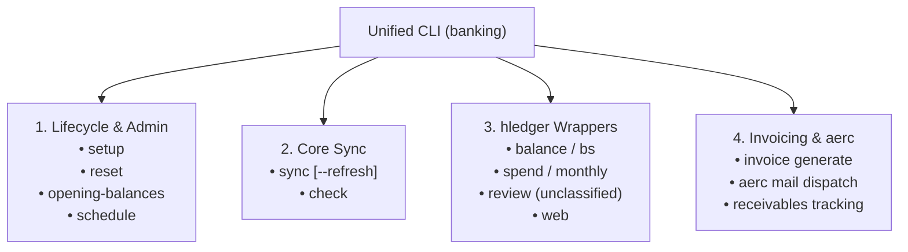

# Banking CLI & Workflow Roadmap

This document outlines the architecture, design specifications, and implementation phases for extending the `banking` plain-text accounting toolchain into a unified CLI with automated scheduling, reporting shortcuts, and `aerc` invoice integration.

---

## 1. Vision & Architecture

Transform the current standalone scripts into a coherent, terminal-first CLI (`banking` command) that handles:
1. **Lifecycle Management**: Guided initial setup, cache/journal resets, and opening balance configuration.
2. **Automated Synchronization**: Background scheduled refresh via systemd user timers or cron.
3. **Curated Reporting**: Quick terminal wrappers for daily `hledger` checks, monthly summaries, and unclassified transaction triage.
4. **Invoicing & Email**: Generating clean client invoices and dispatching them via the `aerc` terminal email client.



---

## 2. Feature Breakdown

### Phase 1: Unified CLI & Lifecycle Management

Create a central CLI entry point (e.g. `src/cli.py` or entrypoint `banking`) using Python's `argparse` or `click`.

#### 1.1 `banking setup`
* **Purpose**: Guided onboarding on a fresh machine or new environment.
* **Workflow**:
  1. Verifies `LUNCHFLOW_API_KEY` in `.env` or prompts for it.
  2. Runs a live connection test to `https://lunchflow.app/api/v1/accounts`.
  3. Discovers available bank accounts and interactively creates `~/.config/banking/config.yaml`.
  4. Seeds default `rules.yaml` if not present.
  5. Runs the initial sync.

#### 1.2 `banking reset`
* **Purpose**: Safe, granular resetting of data and memory.
* **Options**:
  * `--soft` (Default): Clears `data/accounts/fd_*.journal` and `amex.journal` + wipes `sync_state.json`. Preserves `opening_balances.journal` and API cache.
  * `--cache`: Wipes `~/.cache/banking/` to force fresh API downloads on next sync.
  * `--hard`: Complete reset. Removes all journals, state, and cache. Prompts user confirmation before proceeding.

#### 1.3 `banking opening-balances`
* **Purpose**: Inspect and update account starting balances without manual file editing.
* **Workflow**:
  * `banking opening-balances list`: Displays current opening balance entries and dates.
  * `banking opening-balances set <account> <amount> [--date YYYY-MM-DD]`: Interactively updates or adds an opening balance entry in `data/accounts/opening_balances.journal`.
  * Verifies ledger balance alignment against real bank accounts.

#### 1.4 `banking schedule`
* **Purpose**: Configure hands-off daily background syncing.
* **Implementations**:
  * **Option A: Cron** (`crontab -e` helper):
    * `banking schedule install [--time 08:00]`: Adds a cron job executing `sync.py --refresh` daily.
    * `banking schedule remove`: Removes the cron entry.
    * `banking schedule status`: Checks if cron is active and inspects `~/.local/state/banking/sync.log`.
  * **Option B: Systemd User Timer** (`~/.config/systemd/user/banking-sync.{service,timer}`):
    * More idiomatic on modern Linux systems, with built-in logging via `journalctl --user -u banking-sync`.

---

### Phase 2: `hledger` Convenience Wrappers & Triage

Eliminate the need to type long flags (`-f data/all.journal`) and provide formatted, focused financial views.

#### 2.1 Daily Financial Snapshot
* `banking bs`: Runs `hledger -f data/all.journal bs` (Assets, Liabilities, Net Worth).
* `banking balances`: Shows bank cash accounts (`assets:bank`) and debts (`liabilities`).
* `banking spend [--monthly | --tree | --depth N]`:
  * Default: `hledger -f data/all.journal balance expenses --depth 2`
  * With `--monthly`: `hledger -f data/all.journal is --monthly -p "this year"` (Monthly income vs. expense cash flow).

#### 2.2 Unclassified Triage Tool (`banking review`)
* **Problem**: Transactions that don't match `rules.yaml` land in `expenses:unclassified` and need periodic categorization.
* **Solution**:
  1. Queries all transactions in `expenses:unclassified`.
  2. Displays unique merchants and total frequency.
  3. Interactive prompt: *"What category should 'Green Works' be assigned to?"*
  4. Automatically appends the chosen rule to `~/.config/banking/rules.yaml`.
  5. Offers to rebuild/update the ledger immediately.

#### 2.3 Interactive Transaction Editor (`banking edit`)
* **Purpose**: Provide an interactive interface to find and edit individual transactions.
* **Concepts to explore**:
  * Fuzzy search across transactions (via `fzf` or an interactive TUI prompt).
  * Direct jump into `$EDITOR` / `nvim +<line> <journal_file>` positioned on the exact transaction line using its `; lunchflow_id: <id>`.
  * In-terminal category reassignment or split-transaction editing.
  *(Detailed design and interface options to be discussed and refined when reaching this phase).*

#### 2.4 Dashboard Launcher
* `banking web`: Launches `hledger-web -f data/all.journal` on `http://127.0.0.1:5000` with browser auto-open.

---

### Phase 3: Client Invoicing & `aerc` Integration

Track client accounts receivable in `hledger` and dispatch professional invoices directly from the terminal using `aerc`.

#### 3.1 Plain-Text Accounting Invoicing Model
In Double-Entry Accounting, an invoice is an accounts receivable transaction:

```hledger
; When invoice INV-2026-001 is issued to Acme Corp:
2026-09-15 * Acme Corp | Invoice INV-2026-001
    assets:receivables:acme                       £1,500.00
    income:freelance:consulting                  -£1,500.00

; When payment arrives in First Direct:
2026-09-30 * Acme Corp | Payment received
    assets:bank:home                              £1,500.00
    assets:receivables:acme                      -£1,500.00
```
* Shows outstanding unpaid client balances via `hledger balance assets:receivables`.

#### 3.2 Invoice Generator (`banking invoice create`)
* Interactive prompt or YAML template:
  * Client Name & Email
  * Line items (Description, Quantity, Rate)
  * Payment terms & bank details (Sort code, Account number)
* Outputs:
  1. A structured `.journal` entry saved to `data/invoices/2026.journal`.
  2. A rendered PDF or clean plain-text invoice (using Typst, Markdown, or Pandoc).

#### 3.3 `aerc` Dispatch Integration (`banking invoice send <invoice_id>`)
* **Integration mechanism**:
  * Formats email metadata:
    * `To: client@example.com`
    * `Subject: Invoice INV-2026-001 - <Your Name>`
    * `Body`: Professional plain-text invoice note.
    * `Attachment`: Path to rendered invoice PDF.
  * Hands off to `aerc` using its CLI command:
    ```bash
    aerc "mailto:client@example.com?subject=Invoice%20INV-2026-001&attach=/path/to/invoice.pdf"
    ```
    or pipes draft into `aerc mailto` / message composition window.
  * Allows you to review, edit in Neovim (inside `aerc`), and press `Ctrl-j` / `:send` to send.

---

## 3. Milestones & Delivery Schedule

| Milestone | Deliverables | Target Status |
| :--- | :--- | :--- |
| **M1: Baseline Sync** | `client.py`, `formatter.py`, `categorizer.py`, `sync.py`, `opening_balances` | **COMPLETED** |
| **M2: CLI Core** | `banking setup`, `banking reset`, `banking opening-balances` commands | Next Up |
| **M3: Scheduling** | Background cron / systemd user timer installer & logger | Next Up |
| **M4: Reporting UX** | `banking bs`, `banking spend`, `banking review` triage CLI | Planned |
| **M5: Invoicing** | Receivables ledger tracking, invoice generator, `aerc` mailto hook | Future |

---

## 4. File Structure Evolution

```text
banking/
├── config.yaml                # Account and preference mappings
├── rules.yaml                 # Categorization rules
├── PLAN.md                    # Roadmap & specifications (this file)
├── data/
│   ├── all.journal            # Master include journal
│   ├── invoices/              # Invoice accounts receivable records
│   │   └── 2026.journal
│   └── accounts/              # Bank feeds & opening balances
│       ├── opening_balances.journal
│       ├── fd_home.journal
│       ├── fd_personal.journal
│       ├── fd_savings.journal
│       └── amex.journal
└── src/
    ├── __init__.py
    ├── cli.py                 # Main CLI router (setup, reset, schedule, wrappers)
    ├── paths.py               # XDG path helper
    ├── client.py              # Lunchflow API client
    ├── categorizer.py         # Categorization engine
    ├── formatter.py           # PTA transaction formatter
    ├── sync.py                # Sync engine
    ├── scheduler.py           # Cron / systemd scheduler manager
    └── invoicing.py           # Invoice generation & aerc integration
```
